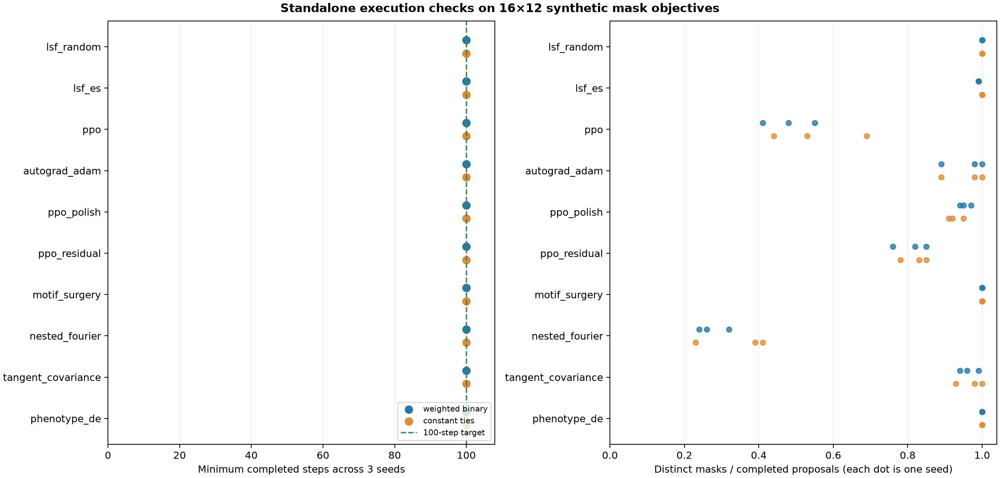
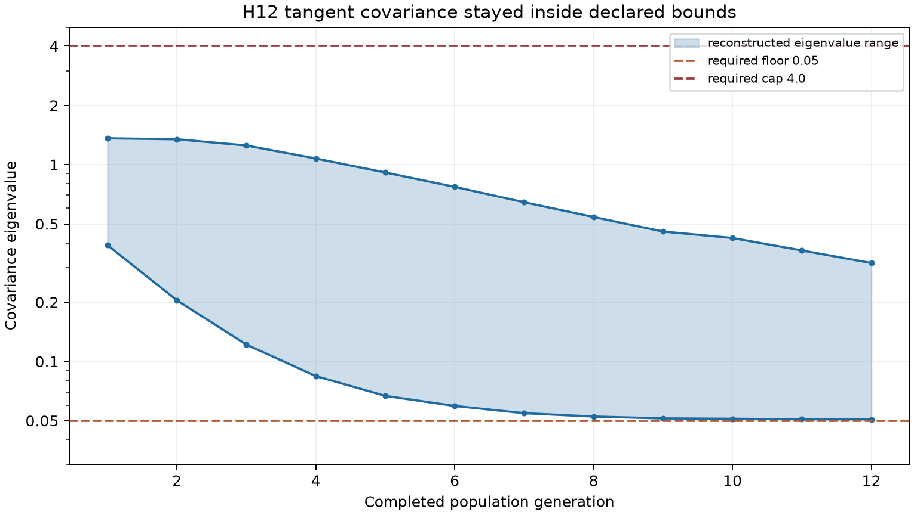

# Standalone optimizer validation report

Tested library source: commit `a89af83e8df5a54c05556edff50eb8e353b0f73b`, package version `0.1.0`. Environment: Python 3.12.3, NumPy 2.5.3, Torch 2.14.0+cu130 for the learner suite. These are algorithm and interface checks; **no MEENT simulation or grating-efficiency measurement was performed**.

## Results

| Check | Result | Evidence |
| --- | ---: | --- |
| Full test suite with Torch | 36 passed, 0 failed | [JUnit XML](pytest-full.xml) |
| Installed wheel with NumPy only | 27 passed, 9 Torch-dependent skipped, 0 failed | [JUnit XML](pytest-numpy-only.xml) |
| Synthetic 100-step runs | 60/60 completed: 10 methods × 2 objectives × 3 seeds | [Run records](results.json) |
| Full-size 256×128 mask check | 10/10 methods emitted and consumed a valid y-symmetric binary mask | [Run records](results.json) |

The 60 runs used a 16×12 mask, seeds 1, 17 and 97, and either a fixed weighted-mask utility or a constant utility that creates score ties. Gradient methods received the analytic relaxed utility `−‖c‖²` and gradient `−2c`. The test completed 100 `propose`/`observe` cycles per run and checked finite scores and candidate size. The full-size check performed one callback evaluation per method, using mask fill fraction as a synthetic score.

All methods completed every requested step. The right panel counts distinct binary masks among 100 proposals; it describes search behavior, **not** the quality of the masks. Nested Fourier produced 23–41 distinct masks per run at this small resolution, so duplicate hard masks are a visible efficiency concern for later use. The test does not establish whether its Hamming-distance target is consistently reached.

## What the unit tests exercise

- **Lifecycle and replay:** for each of the ten methods, three seeds run before and after a checkpoint and produce identical subsequent proposals and diagnostics. An outstanding proposal also survives a checkpoint and resumes with the same next proposal after observation.
- **Port fidelity:** frozen traces from the dqn-meent source compare 12 proposals and update counts for each of the six ported methods. The H12 port matches 20 frozen full-grid decoder masks and 24 proposal/state steps from submitted commit `b0399949537a193f1de85c2d471c62cedbec648f`.
- **Numerical rules:** both Fourier conventions preserve fields and masks when coefficients lift through nested mode limits; the H12 cell-centered decoder matches an independent formula. Covariance refactor respects its spectral floor 0.05 and cap 4.0 on a regression matrix whose uncorrected maximum is 5.475.
- **Mechanism checks:** zero and equal-score H12 updates; nested incumbent preservation; mirrored motif edits; phenotype-bin best-member retention; Adam's injected gradient use; two-step polishing rollback; residual-control signed reward on a cached mask return; and rejection of malformed observations or missing gradients.

The plot below follows one representative H12 run (weighted-mask objective, seed 1). Across its 12 completed generations, the reconstructed covariance eigenvalues ranged from 0.0508 to 1.3612, inside the declared bounds. The implementation also checks these bounds internally on every informative update in the other runs.

## Reproduction and limits

The raw data and figure generator are in [produce.py](produce.py). From the package root, the commands used were `PYTHONPATH=src /home/chs/Work/dqn-meent/.venv/bin/python -m pytest -q` and `PYTHONPATH=src /home/chs/Work/dqn-meent/.venv/bin/python reports/standalone-validation-20260930/produce.py`. The second JUnit report came from a separate environment containing the built wheel, NumPy and pytest, without Torch.

These checks cover short synthetic trajectories and one full-size proposal per method. They do not establish long-run memory use, exhaustive behavior under every parameter setting, numerical agreement with MEENT gradients, or performance on a physical design task. The new motif, nested-Fourier and phenotype-DE mechanisms have focused invariants and stress checks, but no independent reference implementation against which to compare complete trajectories.
